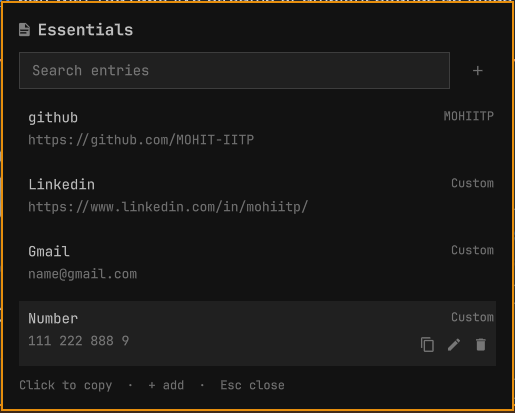

# Essentials

Private, copy-ready personal details in your Omarchy bar: email addresses,
phone numbers, profile links (GitHub, LinkedIn, and any custom URL), addresses,
and free-form values. Everything stays on your machine.

Essentials is an [Omarchy](https://omarchy.org/) shell plugin (bar widget +
panel) built with Quickshell.



## Features

- One bar icon with a searchable panel of saved entries.
- Click an entry to copy its value; hover for Copy, Edit, and Delete actions.
- Group entries (for example `Work`, `Personal`, `Social`).
- Search matches labels, values, and groups.
- `Esc` closes the panel; `Enter` saves from the last edit field.
- Data is stored as plain JSON on the local machine and reloads when changed
  externally, so it survives shell and system restarts.

## Requirements

- Omarchy with the Omarchy shell (Quickshell).
- No extra packages: the panel uses `wl-copy` from `wl-clipboard`, which ships
  with Omarchy.

## Install

Install straight from this repository with the Omarchy plugin command:

```bash
omarchy plugin add https://github.com/MOHIT-IITP/Essentials.git --enable
```

The command clones the plugin into
`~/.config/omarchy/plugins/io.github.mohiitp.essentials/`, validates the
manifest, and enables it. If you prefer to place the widget yourself:

```bash
omarchy plugin add https://github.com/MOHIT-IITP/Essentials.git
omarchy plugin enable io.github.mohiitp.essentials
omarchy bar put io.github.mohiitp.essentials --section right
```

From a local checkout, run the installer instead:

```bash
chmod +x install.sh
./install.sh
```

It copies the plugin files to
`~/.config/omarchy/plugins/io.github.mohiitp.essentials/`, rescans plugins,
enables Essentials, and places it in the right side of the top bar. Existing
saved data is never overwritten.

Confirm the plugin is discovered:

```bash
omarchy plugin list
```

## Use

1. Click the Essentials icon in the bar to open or close the panel.
2. Click an entry to copy its value.
3. Select **+** to create an entry; labels, values, and groups are editable.
4. Type in the search field to filter entries. Search is focused when the
   panel opens.

## Data and privacy

Entries live in a single owner-only JSON file:

```
~/.local/state/omarchy/io.github.mohiitp.essentials.json
```

It stays on your machine and is never uploaded. Back it up by copying that
file. It is plain JSON, so do not store passwords, API tokens, or other secrets
in it. Remove the file to erase all entries.

## Update

```bash
omarchy plugin update io.github.mohiitp.essentials
```

## Remove

```bash
omarchy plugin disable io.github.mohiitp.essentials
omarchy plugin remove io.github.mohiitp.essentials --yes
```

Then delete your saved entries if you no longer want them:

```bash
rm ~/.local/state/omarchy/io.github.mohiitp.essentials.json
```

## Publish

The repository root holds everything the Omarchy plugin marketplace expects:

- `manifest.json` with a unique namespaced id, `kinds: ["bar-widget"]`, and the
  `entryPoints.barWidget` entry.
- This README with installation and removal instructions.
- `LICENSE` (MIT).

Validate before submitting:

```bash
omarchy plugin validate .
```

## License

MIT. See [LICENSE](LICENSE).
